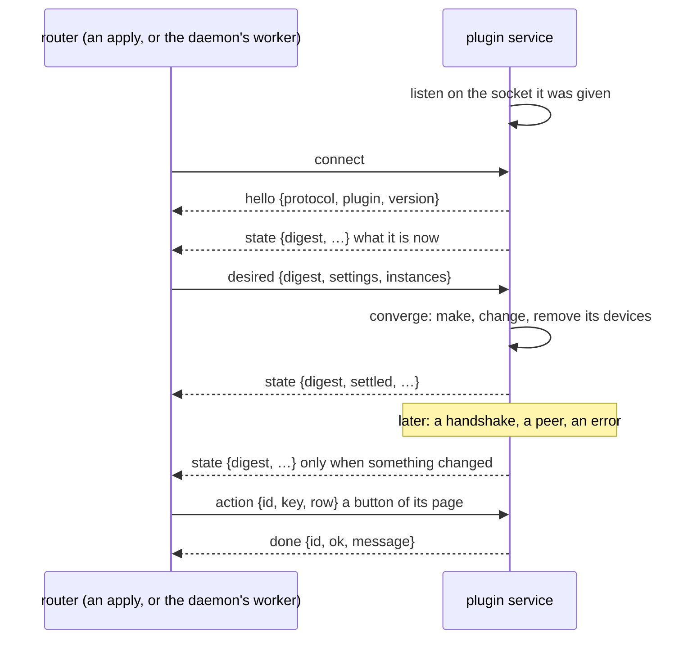

# The channel

How a plugin's service and the routeh router talk. This is the contract
as a plugin's author needs it. The design, with why each rule is what it
is, is `docs/PLUGINS.md` of the router's repository (The channel); the
Rust types of both sides are `routeh-plugin-protocol` (`channel`), and
`routeh-plugin-sdk` speaks it for a plugin written in Rust. A plugin may
speak it in any language.



## The socket

- The service is started by procd, in ujail, with one argument: the path
  of its socket, `<id>.sock` in a directory the router chooses. It finds
  nothing else of the router's: no settings file, no environment.
- It binds a Unix stream socket under another name, `<path>.new`, makes
  it its owner's alone (0600) and renames it into place once it listens,
  so the name answers from the moment it appears.
- It accepts more than one connection at a time: an apply and the
  router's daemon each make one.
- It handles SIGTERM and ends at once, taking its socket away. In its
  jail it is PID 1, and a signal PID 1 does not handle is ignored.

## Lines

- One JSON object a line, ended by `\n`, in both directions.
- **Every message is whole.** `desired` is everything the plugin is to
  be, `state` everything it is: no deltas, no order of events to keep, no
  resynchronization. The last message is the truth.
- What the plugin sends is at most 64 KiB a line, without its end
  (`LINE_LIMIT`): the router ends a connection on a longer one. A plugin
  does not send a longer line.
- `desired` has no line limit of its own: the document it is made from is
  bounded where it enters, and the plugin reads it whole.

## `hello`

The first line the plugin sends on every connection:

```json
{"hello":{"plugin":"awg","protocol":1,"version":"0.3.1"}}
```

`protocol` is the version of this contract, `1`; the router refuses a
plugin that names another. `plugin` is the plugin's id, as its manifest
says; `version` is its manifest's version. A plugin that answers pings
adds `"pings":true`; the SDK always does, so a plugin built with it needs
nothing of its own. Without it the router never pings it.

## `ping` and `pong`

The shortest lines of the channel, on a connection whose `hello` said
`pings`:

```json
{"ping":{}}
{"pong":{}}
```

The router asks at most every 5 seconds per connection, only when that
plugin sent no line of any kind in the last 5 seconds, and never asks
again while one is unanswered. Any line counts as alive. After 15 seconds
without a line the plugin is not answering: its tunnels stop carrying
traffic, and it is alive again with its next line. The SDK answers on the
thread that reads the connection, so a long `converge` is not a dead
plugin, and a process that is stopped answers nothing.

## `desired`: what the router sends

```json
{"desired":{
  "digest":"sha256:5e1d…",
  "instances":{
    "vpn":{"device":"tn_vpn","kind":"tunnel","mark":257,
           "settings":{"listen_port":51820,"endpoint":"vpn.example:51820","jc":4}}
  },
  "settings":{"log_level":"info"}
}}
```

- `digest` is `sha256:` and the SHA-256 in hex of the object without its
  digest, `{"instances":…,"settings":…}` as it is written. The plugin does
  not check it: it says it back in `state`.
- `settings` are the plugin's own (`[plugins.<id>]` of the router's
  document); `instances` every tunnel of its kind, by key, each with the
  device it is to make (named by the router), the mark to put on its
  outer socket and the tunnel's settings. Fields of role `address` are
  not sent: the router sets addresses.
- Each value is written as the document writes it: a duration as
  `"25s"`, bytes in base64, a range as `"100-200"`.
- The plugin converges to it: makes what is new, changes what differs,
  removes what is no longer there, before it reads the next line. It
  keeps nothing across a restart: it is told again.
- A plugin that is turned off is first told the same settings with no
  instance, so it takes away what it made.

## `state`: what the plugin sends

```json
{"state":{
  "digest":"sha256:5e1d…",
  "instances":{
    "vpn":{"message":"","peer":"203.0.113.7:51820","phase":"up",
           "values":{"junk_packets":1204,"last_handshake":1795012345}}
  },
  "rows":{
    "records":{"home":{"message":"","phase":"up","values":{"address":"203.0.113.7"}}}
  },
  "settled":true,
  "values":{"peers_up":1}
}}
```

- Sent on every connection right after `hello`, and to every connection
  whenever something in it changes. Never on a timer: a plugin that reads
  its kernel state every few seconds sends nothing unless it changed.
- `digest` is the `desired` it converged to, `null` before its first one.
- `settled` says it is done with it: nothing left to make or change,
  every instance out of `starting`. An apply waits, within the manifest's
  `settle_within`, for a settled `state` of the digest it sent; an
  instance in `error` fails the apply.
- An instance's `phase` is `starting`, `connecting`, `up`, `down` or
  `error`, with a short `message` and the `peer` it talks to (or `null`).
- `values` are by key, and only keys the manifest declares (`[[status]]`
  for the plugin, `[[tunnel.status]]` for an instance), each of its type:
  `text`, `count`, `bytes`, `duration` (seconds), `time` (seconds since
  1970 UTC: a moment, not an age) or `address`. The router drops an
  undeclared key and shows a value of the wrong type as missing.
- `rows` are the rows of a group of the plugin's own settings that a
  status value or an action is `of` (below), by the group and the row's
  key (the value of the group's `key` field), each like an instance
  without a peer. Its values are those declared `of` that group. The
  router drops a group nothing is of, and a row the document does not
  have (a record that was deleted).
- Traffic is not in it: the router counts every device itself.

## `action` and `done`

A person presses a button of the plugin's page (`[[actions]]`). An
action does something now and changes no configuration; it never runs
by itself or on a schedule.

```json
{"action":{"id":7,"key":"update_now","row":"home"}}
{"done":{"id":7,"message":"Updated to 203.0.113.7","ok":true}}
```

- The router sends `action` with an `id` of its own, the action's `key`
  and, for an action `of` a group, the `row` it is done to (absent
  otherwise). It sends only actions the manifest declares, a row exactly
  when the action is of a group, and one action of a plugin at a time.
- The plugin answers on the same connection with `done`: the same `id`,
  whether it did it (`ok`), and a message for the person, at most 1024
  characters (`MESSAGE_LIMIT`). The router waits 30 seconds for it.
- An action before any `desired` is answered `ok: false`. What the action
  changed is in the next `state`.

## Logs

Not through the channel. The plugin writes to the system log
(`/dev/log`, mounted into its jail) with its id as the program; an
instance's lines carry its key (`awg/vpn`).

## Versions

- `protocol` in `hello` is the version of this channel, now `1`.
- `api` in the manifest is the version of the manifest's schema, now
  `1` (`API`); a manifest written for another is refused.

## The manifest of a page

A plugin with a page of its own declares it, and the router draws it:
the form of its settings, its status, its buttons. The plugin writes no
markup and serves no HTTP.

```toml
id = "ddns"
name = "Dynamic DNS"
version = "0.1.0"
api = 1

[service]
command = "bin/ddns"

[page]                        # optional: an item of the navigation
title = "Dynamic DNS"
icon = "globe"                # optional, one of the router's icons

[settings]
token = { type = "text", secret = true, required = true, label = "API token" }

[settings.records]            # a group: a table of rows
type = "group"
label = "Records"
key = "host"                  # names a row: in state, in actions
max_rows = 16
columns = ["host", "domain", "uplink"]

[settings.records.fields]
host = { type = "text", required = true, label = "Host" }
domain = { type = "text", required = true, label = "Domain" }
uplink = { type = "uplink", required = true, label = "Uplink" }

[[form]]
title = "Account"
fields = ["token"]

[[form]]
title = "Records"
fields = ["records"]

[[status]]                    # a value of each row of records
of = "records"
key = "address"
label = "Address"
type = "address"

[[actions]]                   # a button in each row; without `of`, one for the page
key = "update_now"
label = "Update now"
of = "records"
```

- **A group** in `[settings]` is a table of rows, as in a tunnel's
  settings: `fields`, `columns` (every field once), `max_rows` (1 to
  256, 16 if absent). A group holds no group, and a list holds no group.
- **Its `key`** is one of its fields, required, of type `text` or a
  reference. Rows are named once by it, ignoring ASCII case
  (`records.1.host: HOME is named twice`). A group that a status value or
  an action is `of` must have one.
- **References** `uplink`, `network`, `tunnel` and `client` name a
  section of the router's document by its key. They may be a field, a
  cell of a group or the item of a list. The manifest checks only the
  key's form (1 to 32 lowercase letters, digits or underscores); the
  router checks the section is there, offers its sections by name, and
  refuses to delete one a plugin names. `desired` carries the key.
- **`[[status]]`** with `of = "<group>"` is a value of each row of that
  group; without it, a value of the plugin. A tunnel's status has no
  `of`.
- **`[[actions]]`**: `key` (1 to 32 lowercase letters, digits or
  underscores, starting with a letter; each once), `label`, and
  optionally `of = "<group>"`. At most 32.
